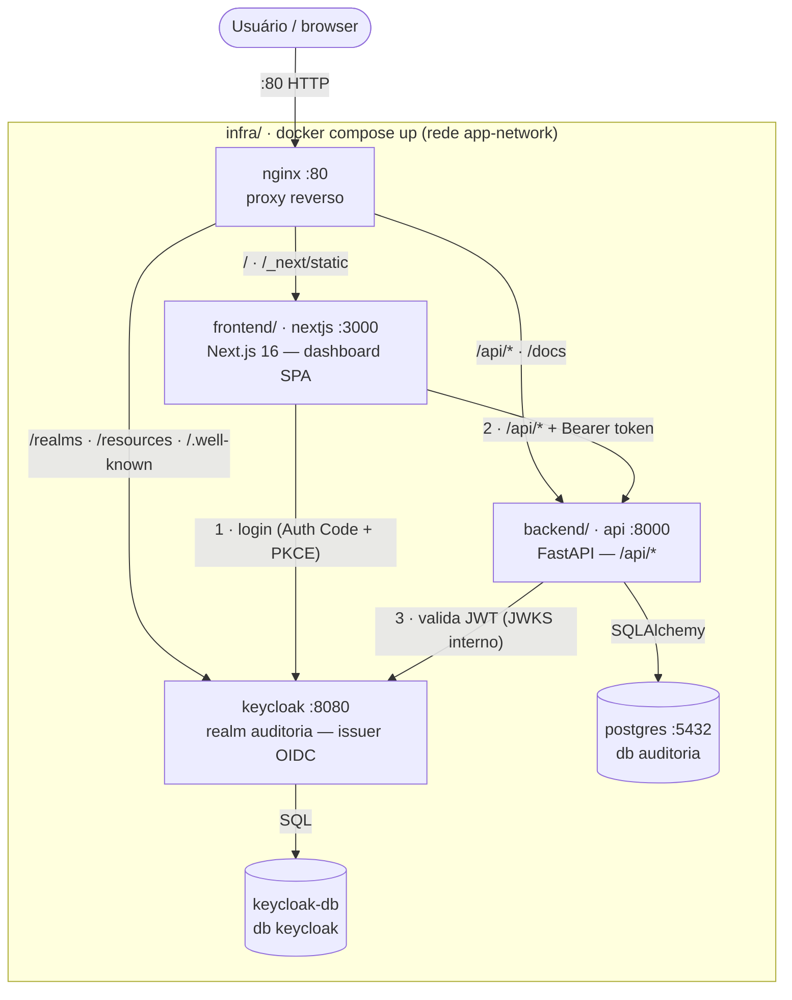
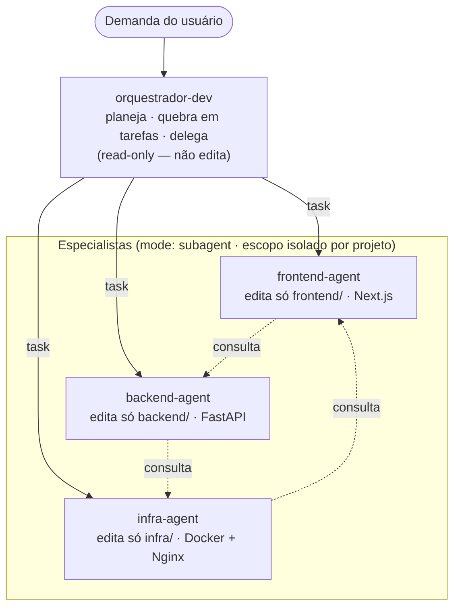

# AuditorIA

**AuditorIA** é uma plataforma de análise automatizada de repositórios de código com agentes de IA.
Este é o **monorepo** que reúne os três projetos da plataforma.

## Projetos

| Diretório | Projeto | Stack | Doc |
|---|---|---|---|
| [`frontend/`](./frontend) | Web app (dashboard) | Next.js 16 + React 19 + Bootstrap 5.3 | [`frontend/README.md`](./frontend/README.md) |
| [`backend/`](./backend) | API REST | FastAPI + SQLAlchemy 2.0 + PostgreSQL | [`backend/README.md`](./backend/README.md) |
| [`infra/`](./infra) | Orquestração | Docker Compose + Nginx + Keycloak | [`infra/README.md`](./infra/README.md) |

> A documentação **factual** do stack (serviços, portas, envs, rotas do nginx) é o
> [`infra/README.md`](./infra/README.md). Regras para agentes estão nos `AGENTS.md`.

## Arquitetura



> Em dev, o `next dev` (`:3000`) faz proxy de `/api/*` direto para `http://localhost:8000` —
> nginx e a rede Docker não entram nesse caminho.

## Como rodar (desenvolvimento)

Pré-requisitos: **Docker** 24+ / **Docker Compose** v2.23+, **Python** 3.11+ e **Node.js** 18+.

```bash
# 1. PostgreSQL + Keycloak (IdP OIDC) a partir de infra/
cd infra
cp .env.example .env
docker compose up -d postgres keycloak

# 2. API (FastAPI) a partir de backend/
cd ../backend
cp .env.example .env
python -m venv .venv && source .venv/bin/activate
pip install -e ".[dev]"
uvicorn app.main:app --reload      # http://localhost:8000/docs

# 3. Web app (Next.js) a partir de frontend/
cd ../frontend
cp .env.example .env.local
npm install
npm run dev                        # http://localhost:3000
```

Em dev, o Next.js faz proxy de `/api/*` para `http://localhost:8000/api/*` (sem CORS e sem nginx).
Todas as rotas `/api/*` exigem login OIDC (Bearer token do Keycloak); apenas `/health` é público.

## Stack completa (produção)

```bash
cd infra
docker compose up -d --build
# Web app:        http://localhost/
# API (Swagger):  http://localhost/docs
# Health check:   http://localhost/health
# Keycloak:       http://localhost:8080/
```

## Estrutura

```
.
├── frontend/   # Next.js (dashboard SPA + OIDC)
├── backend/    # FastAPI (CRUD + validação JWT)
├── infra/      # docker-compose.yml, nginx.conf, keycloak/, scripts/init.sql
├── .opencode/  # agentes e comandos (orquestração de desenvolvimento)
├── AGENTS.md   # regras para agentes neste monorepo
└── README.md
```

## Arquitetura de agentes

Agentes definidos em [`.opencode/agent/`](./.opencode/agent): um **orquestrador** que planeja e
delega, e um **especialista** por projeto.



> Cada especialista só lê/edita o **próprio** projeto e consulta os outros dois via `task`
> (consulta mútua). O orquestrador apenas lê os três projetos e nunca edita arquivos.
> `.env` é sempre negado; `*.env.example` é liberado.

## Licença

Distribuído sob a licença **MIT** — veja [`LICENSE`](./LICENSE).
